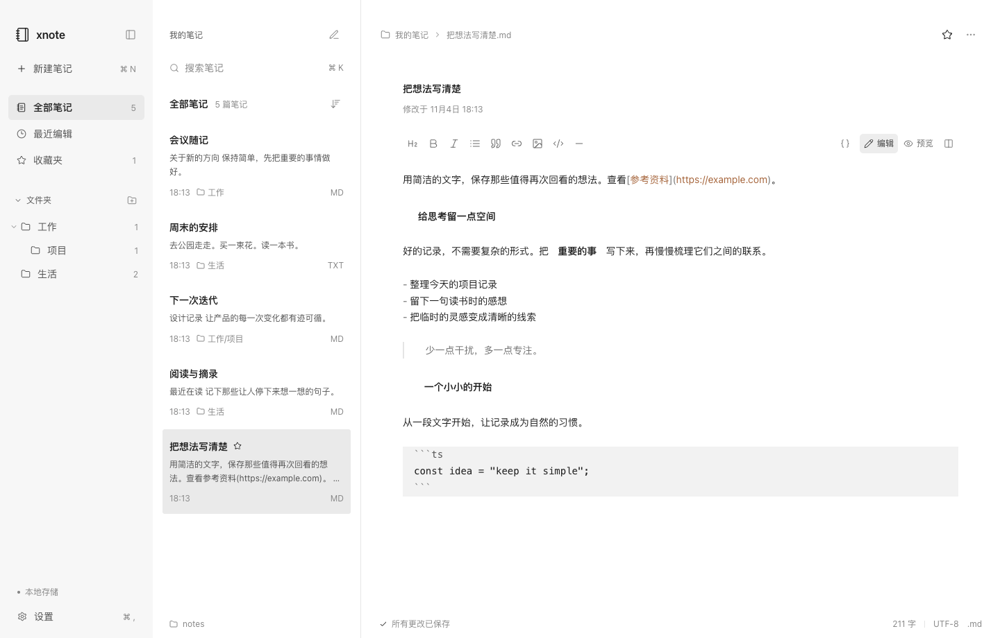

# xnote

一款本地优先的桌面笔记应用，为日常记录、学习整理和代码备忘提供安静的写作空间。基于 React、TypeScript 和 Electron，笔记直接保存为 `.md`、`.markdown` 或 `.txt` 文件，可用其他编辑器继续打开。



## 功能概览

- **本地文件存储**：自选笔记目录，支持文件夹管理、目录切换与迁移，正文不插入应用专有数据。
- **三栏写作界面**：导航、笔记列表与正文分区，支持拖动调整栏宽、折叠导航，正文最大宽度 800px。
- **统一外观**：黑白灰界面、线性图标，支持浅色、深色和跟随系统；正文可选系统、衬线、等宽字体及 12 / 14 / 16px 字号，默认 14px。
- **Markdown 编辑**：非当前行即时排版、完整源码切换、预览与分屏，提供格式工具栏、选中文本右键菜单和操作提示。
- **内置模板**：Q&A、学习、代码与空白 Markdown 四种模板，共用原有编辑与保存流程。
- **笔记检索**：标题与正文全文搜索、关键词高亮、收藏、近 7 天最近编辑，以及修改时间排序。
- **自动保存与冲突处理**：输入停顿后自动保存，检测外部文件变更，冲突时支持保留副本或载入磁盘版本。

## 快速开始

需要 **Node.js 22.12+** 和 npm，项目 `.nvmrc` 指定 Node.js 24。

```bash
nvm install
nvm use
npm ci
npm run dev:desktop
```

桌面开发模式会启动本机文件服务、Vite 和 Electron。首次安装依赖需要下载 Electron。

### 浏览器开发

```bash
npm run dev
```

打开 [本地开发页面](http://127.0.0.1:5173)。浏览器模式通过本机服务读写真实文件；切换保存目录时需在设置中填写完整路径。原生文件夹选择、在 Finder / Explorer 中打开目录及关闭窗口前保存由桌面版本提供。

开发服务仅绑定 `127.0.0.1`，应仅在本机使用。

### 运行生产构建

```bash
npm run build
npm start
```

`build` 包含 TypeScript 检查、前端打包及 Electron 主进程和预加载脚本构建；`start` 运行已生成的桌面构建。源码更新后需重新构建，才能通过 `npm start` 查看最新版本。

## 使用说明

### 新建笔记与模板

点击「新建笔记」选择 Markdown 或纯文本，也可在设置中指定默认类型。

左侧「模板」打开模板中心，点击「使用模板」创建本地 `.md` 文件并进入编辑器：

| 模板     | 初始内容                                             |
| -------- | ---------------------------------------------------- |
| Q&A 笔记 | 问题、原始内容、答案、详细解释和补充记录             |
| 学习笔记 | 学习目标、核心知识点、详细记录、学习总结和待解决问题 |
| 代码笔记 | 使用场景、代码内容、实现思路、关键知识点和注意事项   |
| 空白笔记 | 空正文，不插入标题或占位内容                         |

标题同步到文件名并保留原扩展名。普通笔记默认名为 `Untitled`；文件名冲突时，新建操作自动递增编号，例如 `Untitled 2`，不会覆盖已有文件。

列表中 Q&A 笔记显示 `Q&A`，其他 Markdown 和纯文本分别显示 `MD`、`TXT`。分类保存在本机应用配置中，随应用内重命名、删除和目录迁移更新；单独复制文件或在外部移动文件不会携带分类，普通 Markdown 也不会按正文自动识别为 Q&A。

### 编辑与预览

- Markdown 支持标题、粗体、斜体、列表、引用、行内代码、代码块、链接、图片、表格、任务列表和分割线。编辑器为 JS / TS / JSX / TSX 围栏代码提供语言高亮。
- 工具栏显示当前格式状态；选中文本后右键可应用格式，包含行内代码。格式修改支持撤销与重做，工具栏按钮支持悬停和键盘焦点提示。
- 默认隐藏非当前行的 Markdown 标记墨迹，保留源码布局；可切换为完整源码、预览或分屏。正文超过 100,000 字符时自动使用源码编辑。
- 普通正文按 Enter 插入换行，Shift+Enter 插入 Markdown 显式换行；列表、引用和代码块沿用 Markdown 编辑器的按键处理。预览保留普通文本换行，不改写文件内容。
- TXT 使用纯文本编辑，不插入 Markdown 格式。
- 支持 HTTPS 图片和笔记目录内的相对路径图片，例如 ``。本地位图最大 10MB，支持 PNG / JPEG / GIF / WebP / AVIF / BMP；SVG 不加载。

### 整理与界面

搜索实时匹配全部笔记的标题与正文；笔记列表可按修改时间升序或降序排列，「最近编辑」显示近 7 天的笔记。

右键笔记可收藏或删除，右键文件夹可创建子文件夹、重命名或删除空文件夹。删除前会再次确认，**删除会永久移除本地文件**。

拖动栏间分隔线可调整导航和列表宽度，也可在分隔线获得焦点后使用左右方向键调整。栏宽、折叠状态、字体、字号、主题和上次笔记会持久保存，桌面窗口尺寸与位置在关闭时记忆。

macOS 桌面提供关闭、最小化和全屏按钮；按住 Option 点击全屏按钮可切换窗口缩放。

## 保存、同步与迁移

### 文件与配置

桌面版默认保存到系统 Documents 目录下的 `xnote/`，macOS 通常为 `~/Documents/xnote/`。首次启动会创建默认目录；已选目录失效时保留设置并提示重新选择。

```text
xnote/
├── 工作/
│   ├── 项目记录.md
│   └── 会议纪要.txt
├── images/
│   └── sketch.png
└── 随手记.md
```

标题来自文件名，正文保留原始文件内容，不插入隐藏前言或应用标记。收藏、模板分类及偏好保存在 Electron 的 `app.getPath('userData')`，macOS 通常为 `~/Library/Application Support/xnote/`；浏览器开发模式保存在 `~/.config/xnote/`。两种模式的元数据分别保存。

这里的同步指本地文件的外部变更检测，不提供内置云同步服务。

### 自动保存与外部变更

正文停止输入约 650ms 后自动保存；点击底部保存状态或按 ⌘S / Ctrl+S 可手动保存。切换笔记或目录前先完成保存，失败时保留当前草稿。

应用每 2 秒检查目录，未变化的文件使用元数据缓存。未编辑的笔记自动显示外部变更；存在本地草稿时停止覆盖，提供「保留为副本」或确认「载入磁盘版本」。保存前检查 SHA-256 内容版本，写入临时文件、刷盘后原子替换。

未保存草稿还会尽力备份到本机 Web Storage，启动恢复上次笔记时检查草稿。关闭桌面窗口时等待保存，失败则可返回编辑器或明确放弃修改。强制结束进程、磁盘故障或清理浏览器存储仍可能导致草稿丢失，建议正常备份笔记目录。

### 切换目录与迁移

在「设置 → 文件存储」中选择：

1. **使用新目录**：直接读取目标目录已有文件，保留原目录文件。
2. **迁移现有笔记**：确认后检查冲突，复制全部文件（含图片等附件），校验内容和源目录清单，成功后切换。
3. 新目录不存在时，需勾选「目录不存在时创建」。不能选择包含应用配置目录的目录作为笔记根目录。

迁移保留源目录作为备份。同名冲突、权限错误、源文件中途变化或符号链接都会中止操作，不覆盖目标已有文件。

### 文件边界

路径限制在用户选择的根目录内，拒绝读取符号链接。仅索引支持的 UTF-8 笔记文件，每篇上限 25MB；不支持或无法读取的文件保持原样并给出提示。

外部程序不参与应用的操作锁，版本检查与系统调用之间仍有极短竞争窗口，原子写入不等于跨程序事务。模板创建和笔记重命名使用排他硬链接避免覆盖；exFAT / FAT 等不支持硬链接的卷可能返回错误，普通 MD / TXT 新建使用独占创建方式。

## 快捷键

下表以 macOS 为例，Windows / Linux 将 ⌘ 替换为 Ctrl。

| 操作                 | 快捷键                    |
| -------------------- | ------------------------- |
| 新建默认类型笔记     | ⌘ N                       |
| 搜索全部笔记         | ⌘ P；非编辑器焦点也可 ⌘ K |
| 保存                 | ⌘ S                       |
| 打开设置             | ⌘ ,                       |
| 折叠 / 展开侧边栏    | ⌘ \\                      |
| Markdown 粗体 / 斜体 | ⌘ B / ⌘ I                 |
| Markdown 插入链接    | 编辑器内 ⌘ K              |
| Markdown 列表        | ⌘ ⇧ 7                     |
| 撤销 / 重做          | ⌘ Z / ⌘ ⇧ Z               |
| 全选                 | ⌘ A                       |

## 构建与打包

```bash
npm run package   # 生成应用目录，按当前系统和架构构建
npm run dist      # 生成分发包：macOS DMG/ZIP、Windows NSIS、Linux AppImage
```

产物输出到 `release/`，例如 macOS arm64 应用目录为 `release/mac-arm64/xnote.app`。此目录不纳入版本控制，已有安装包可能早于当前源码；需要最新安装包时请重新运行打包命令。

应在目标操作系统上构建和测试。仓库已有 macOS arm64 的原生运行与打包验收记录，Windows / Linux 未实机验证。当前打包配置未包含代码签名和 macOS 公证，分发前需另行配置。

## 开发与验证

```bash
npm test                         # 真实临时目录文件测试、模板与编辑器规则测试
npm run typecheck                # TypeScript 检查
npm run build                    # Web 与 Electron 构建
npx playwright install chromium
npm run test:e2e                 # 浏览器端到端测试，自动启动本地服务
```

端到端测试默认使用 Web 端口 `5173`、API 端口 `4318`，默认数据目录为 `/tmp/xnote-e2e`。已有开发服务运行时，可指定独立端口和临时目录：

```bash
XNOTE_WEB_PORT=5183 XNOTE_API_PORT=4328 XNOTE_HOME="$(mktemp -d /tmp/xnote-e2e-XXXXXX)" npm run test:e2e
```

已安装 Chrome 时，可设置 `XNOTE_BROWSER_CHANNEL=chrome` 使用本机浏览器。

原生验证脚本使用现有构建，**运行前先执行 `npm run build`**：

```bash
npm run test:desktop
npm run test:ui
npm run test:ui:round3
npm run test:ui:round4
node --import tsx scripts/test-templates-desktop.ts
node --import tsx scripts/test-window-controls-desktop.ts
```

这些脚本使用临时目录验证真实 Electron 与本地文件，部分脚本会更新 `docs/` 截图。可通过 `XNOTE_EXECUTABLE` 指定打包后的可执行文件运行支持该选项的桌面验证脚本。

| 环境变量                | 用途                                                           |
| ----------------------- | -------------------------------------------------------------- |
| `XNOTE_HOME`            | 隔离开发 / 测试数据，笔记位于其 `notes/`，配置位于其 `config/` |
| `XNOTE_WEB_PORT`        | 开发 Web 端口，默认 `5173`                                     |
| `XNOTE_API_PORT`        | 开发文件服务端口，默认 `4318`                                  |
| `XNOTE_BROWSER_CHANNEL` | Playwright 浏览器通道，例如 `chrome`                           |
| `XNOTE_EXECUTABLE`      | 部分原生验证脚本使用的已打包应用可执行文件路径                 |

日常使用无需设置这些变量。开发服务鉴权令牌由启动脚本自动生成。

历史验收记录按各自日期和范围保留，不代表当前代码已重新执行全部验收：

- [模板中心验证](docs/template-center-verification.md)：模板创建、分类、文件安全及原生流程。
- [灰度 UI 验证](docs/ui-round4-verification.md)：主题、字号、图标和多尺寸界面。
- [编辑器与 UI/UX 验证](docs/ui-round3-verification.md)：输入、光标、格式及响应式布局。
- [第二轮 UI 验证](docs/ui-round2-verification.md)：三栏布局与即时排版。
- [初始功能与打包验证](docs/verification.md)：文件存储、迁移、原生窗口和平台边界。

## 项目结构

```text
src/
├── App.tsx                    # 三栏界面、导航、搜索与操作菜单
├── types.ts                   # 文件服务契约、设置和桌面 API 类型
├── theme.css                  # 颜色、字体、尺寸及交互变量
├── styles.css                 # 应用布局与界面样式
├── lib/
│   ├── api.ts                 # Electron IPC / 浏览器请求桥接
│   ├── useWorkspace.ts        # 草稿、保存队列、冲突与同步状态
│   └── noteTemplates.ts       # 前端与文件服务共用的模板配置
└── components/
    ├── NoteEditor.tsx         # CodeMirror 编辑器、格式菜单与 Markdown 预览
    ├── markdownPresentation.ts # 即时排版装饰，不修改文档内容
    ├── remarkLineBreaks.ts    # 预览保留普通文本换行
    ├── TemplateCenter.tsx     # 模板中心
    ├── TooltipButton.tsx      # 支持悬停及键盘焦点的操作提示
    ├── WindowControls.tsx     # macOS 桌面窗口控制
    ├── PreviewImage.tsx       # 笔记根目录内的图片读取
    ├── Settings.tsx           # 外观、字体、存储与迁移设置
    ├── Modal.tsx              # 对话框与键盘焦点管理
    └── *.css                  # 编辑器、设置、模板等组件样式
server/
├── store.ts                   # 串行文件操作、校验、分类与目录迁移
└── index.ts                   # 开发环境本机鉴权服务
electron/
├── main.ts                    # 原生窗口、目录选择、IPC 与关闭前保存
└── preload.ts                 # 隔离环境下的窄权限 API
scripts/                       # 开发启动、构建与原生验证
tests/                         # 单元、文件集成与浏览器端到端测试
docs/                          # 设计计划、历史验收记录与截图
build/                         # 应用图标资源
```

内置模板集中定义在 `src/lib/noteTemplates.ts`；扩展模板时在此配置默认标题、说明、图标、正文和分类，无需新增创建接口。

Electron 关闭 Node integration，开启 context isolation 和 sandbox，IPC 校验主窗口来源；不将通用文件系统或 IPC 对象暴露给渲染器。Markdown 预览不执行原始 HTML，链接和图片经 URL 校验。浏览器开发请求通过 Vite 代理附加每次启动生成的鉴权令牌。
