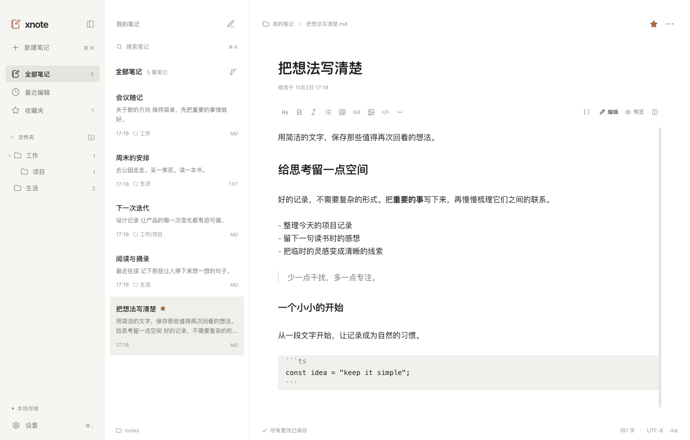

# xnote

一款本地优先的桌面笔记应用。React + TypeScript + Electron，笔记直接保存为可被其他编辑器打开的 `.md`、`.markdown` 和 `.txt` 文件。



第二轮界面采用平面笔记列表、800px 居中正文和轻量工具栏。折叠导航保留常用入口，文件夹支持展开收起；Markdown 在非当前行提供即时排版，并保留源码、预览和分屏。超过 100,000 字符时使用源码编辑以保持流畅。

当前安装包位于 `release/`（`xnote-1.0.0-arm64.dmg` 和 `xnote-1.0.0-arm64-mac.zip`），使用最新版浅蓝渐变图标。旧的 `ui-round2/` 等目录是历史产物。视觉与功能验收见 [第二轮 UI 验证记录](docs/ui-round2-verification.md)。

## 启动

需要 **Node.js 22.12+，推荐 Node.js 24 LTS**，以及 npm。项目提供 `.nvmrc`。

```bash
nvm install
nvm use
npm install
npm run dev:desktop
```

桌面开发模式会启动 Vite 和 Electron。第一次安装需要下载 Electron，网络较慢时可使用 `npm install --registry=https://registry.npmjs.org`。

浏览器开发模式同样连接真实文件系统，不使用假数据：

```bash
npm run dev
```

打开 http://127.0.0.1:5173 。浏览器模式通过本机服务访问文件，需要在设置中填写此电脑的完整保存路径；原生文件夹选择、打开 Finder/Explorer 和窗口关闭保存由桌面版本提供。仅在本机使用开发服务，不要暴露至公网。

生产运行：

```bash
npm run build
npm start
```

## 打包

```bash
npm run package   # 生成应用目录，macOS 为 release/mac-arm64/xnote.app（按本机架构）
npm run dist      # 生成当前系统的分发包：macOS DMG/ZIP、Windows NSIS、Linux AppImage
```

应在相应目标操作系统上构建和测试。此项目已在 macOS arm64 验证原生运行与应用目录打包，Windows/Linux 未实机验证。发布给其他用户前需自行配置代码签名及 macOS 公证；当前构建为本地开发用未签名应用。

## 使用

- 点击「新建笔记」选择 Markdown 或纯文本，也可在设置中指定默认类型。
- 左侧「模板」提供 Q&A 笔记、学习笔记、代码笔记和真正空白的 Markdown 笔记。点击「使用模板」会创建本地 `.md` 文件并进入原有编辑器；文件重名时自动递增编号。
- 标题同步到文件名，并保留原扩展名。默认名为 `Untitled`，重名时依次生成 `Untitled 2` 等。已有同名文件不会被覆盖。
- 正文停止输入约 650ms 后自动保存；点击底部保存状态或按 ⌘S / Ctrl+S 手动保存。
- Markdown 支持语法高亮、轻量格式按钮、撤销重做、编辑/预览/分屏、列表、引用、代码、链接、图片、表格和任务列表。TXT 保持纯文本体验。
- 支持 HTTPS 图片和笔记目录内的相对路径图片，例如 ``。本地位图最大 10MB，支持 PNG/JPEG/GIF/WebP/AVIF/BMP；SVG 不加载。
- 搜索实时匹配全部笔记的标题与正文，并标记关键词；列表可按修改时间升序或降序排列。「最近编辑」显示近 7 天的笔记。
- 星标收藏常用笔记。右键笔记可收藏或删除；右键文件夹可创建子文件夹、重命名或删除空文件夹。删除前再次确认，**删除为永久删除本地文件**。
- 拖动栏间分隔线调整导航和列表宽度；宽度、折叠状态、字号、字体、主题和上次笔记会持久保存。桌面窗口尺寸和位置在关闭时记忆。

## 本地存储和同步

默认保存到 `~/Documents/xnote/`（Windows 使用系统 Documents 目录）。第一次启动才创建默认目录；已选目录失效时保留设置并提示重新选择，不会悄悄更换或重建丢失的目录。

```text
xnote/
├── 工作/
│   ├── 项目记录.md
│   └── 会议纪要.txt
├── images/
│   └── sketch.png
└── 随手记.md
```

标题来自文件名，正文完全保持原始文件内容，不插入隐藏前言或应用标记。收藏和设置位于 Electron `app.getPath('userData')`（macOS 通常为 `~/Library/Application Support/xnote/`）；浏览器开发模式位于 `~/.config/xnote/`。开发模式和桌面模式的元数据分别保存。

模板分类也保存在现有配置中，Q&A 在笔记列表显示浅灰色 `Q&A`，其他 Markdown 和纯文本分别显示 `MD`、`TXT`。分类随应用内的重命名、删除和目录迁移更新；普通 Markdown 不根据标题或正文自动识别为 Q&A。使用第三方编辑器打开文件时，正文仍是完整的标准 Markdown。

内置模板集中定义在 `src/lib/noteTemplates.ts`，页面与文件服务共用该配置。增加模板时可在此补充默认标题、说明、图标、初始正文及分类，无需新增创建接口。模板中心验收记录见 [模板中心验证](docs/template-center-verification.md)。

应用每 2 秒检查目录，内容未修改的文件使用元数据缓存。未编辑的笔记自动显示外部变更；存在本地草稿时停止覆盖，提供「保留为副本」或确认「载入磁盘版本」。保存前检查 SHA-256 内容版本，写入临时文件、刷盘后原子替换。切换笔记和目录前先完成保存，保存失败时保留当前草稿。

未保存草稿还会尽力备份到本机 Web Storage。启动恢复上次笔记时会检查草稿。关闭桌面窗口时等待保存，失败则提供返回编辑器或明确放弃修改；强制结束进程、磁盘故障及浏览器清理存储无法保证恢复，因此仍建议对笔记目录正常备份。

设置 → 文件存储支持切换目录或迁移：

1. 「使用新目录」直接读取目标已有文件，原文件不变。
2. 「迁移现有笔记」确认后先检查所有冲突，再复制全部文件（含图片等附件），校验内容和源目录清单，成功后切换。
3. 迁移保留原目录作为备份，不自动删除源文件。同名冲突、权限错误、源文件中途变化或符号链接都会中止，不覆盖目标已有文件。
4. 新目录不存在时，需要勾选「目录不存在时创建」。不可选择包含应用配置目录的目录作为笔记根目录。

路径限制在用户选择的根目录内，拒绝读取符号链接。默认只索引 UTF-8 文本，每篇笔记上限 25MB；不支持或无法读取的文件保持原样，并给出提示。外部程序不参与应用的锁，版本检查与系统调用间仍有极短竞争窗口；原子写入不等于跨程序事务。模板创建及笔记重命名使用排他硬链接避免覆盖，exFAT/FAT 等不支持硬链接的卷可能返回明确错误；普通 MD/TXT 创建仍使用原有的独占创建方式。

## 快捷键

macOS 使用 ⌘，Windows / Linux 使用 Ctrl。

| 操作                 | 快捷键                    |
| -------------------- | ------------------------- |
| 新建默认类型笔记     | ⌘ N                       |
| 搜索全部笔记         | ⌘ P；非编辑器焦点也可 ⌘ K |
| 保存                 | ⌘ S                       |
| 设置                 | ⌘ ,                       |
| 折叠/展开侧边栏      | ⌘ \\                      |
| Markdown 粗体 / 斜体 | ⌘ B / ⌘ I                 |
| Markdown 插入链接    | 编辑器内 ⌘ K              |
| 撤销 / 重做          | ⌘ Z / ⌘ ⇧ Z               |
| 全选                 | ⌘ A                       |

## 测试

```bash
npm test                 # 真实临时目录文件测试 + 编辑器规则测试
npm run typecheck
npm run build
npx playwright install chromium
npm run test:e2e          # 启动本地服务，以真实临时文件运行 Chromium 测试
npm run test:desktop      # 先 build，验证原生 Electron、IPC、关闭保存，更新 docs 截图
npm run test:ui           # 先 build，运行原生多尺寸 UI 验收并生成截图
```

端到端测试默认使用 5173/4318 端口。已有开发服务运行时，可使用独立端口和临时目录：

```bash
XNOTE_WEB_PORT=5183 XNOTE_API_PORT=4328 XNOTE_HOME="$(mktemp -d /tmp/xnote-e2e-XXXXXX)" npm run test:e2e
```

`XNOTE_HOME` 只用于隔离开发/测试，将笔记放到该目录的 `notes/`、元数据放到 `config/`。生产不设置该环境变量即可。

测试结果与平台边界见 [docs/verification.md](docs/verification.md)。

## 结构

```text
src/
├── App.tsx                   # 三栏界面、导航、搜索、操作菜单
├── types.ts                  # 文件服务契约与设置类型
├── theme.css                 # 颜色、字体、间距和交互设计变量
├── styles.css                # 三栏布局与界面样式
├── lib/
│   ├── api.ts                # 原生 IPC / 浏览器请求桥接
│   └── useWorkspace.ts       # 草稿、保存队列、冲突和同步状态
└── components/
    ├── NoteEditor.tsx         # CodeMirror 编辑器与安全 Markdown 预览
    ├── markdownPresentation.ts # Markdown 呈现装饰，不修改文档
    ├── editor.css             # 编辑器排版与工具栏
    ├── settings.css           # 设置和共享弹窗
    ├── PreviewImage.tsx       # 根目录内图片读取
    ├── Settings.tsx           # 外观、字体、存储与迁移
    └── Modal.tsx              # 键盘焦点与对话框
server/
├── store.ts                  # 与 UI 无关的文件服务，串行操作、校验、迁移
└── index.ts                  # 开发环境的鉴权 loopback 服务
electron/
├── main.ts                   # 原生窗口、目录选择、IPC、关闭前保存
└── preload.ts                # 隔离环境下的窄权限 API
scripts/                      # 启动、构建、原生验证
tests/                        # 单元、文件集成、浏览器端到端测试
```

Electron 关闭 Node integration，开启 context isolation 和 sandbox，IPC 校验主窗口来源；不将通用文件系统或 IPC 对象暴露给渲染器。Markdown 不执行 HTML。开发服务绑定 `127.0.0.1`，由 Vite 代理附加每次启动随机生成的鉴权令牌。

技术选型参考 [Electron 安全指南](https://www.electronjs.org/docs/latest/tutorial/security/) 与 [CodeMirror Markdown 组件](https://github.com/codemirror/lang-markdown)。空仓库原环境没有 Rust，因此采用 Electron，文件服务与前端已解耦，未来可替换桌面桥接层。
