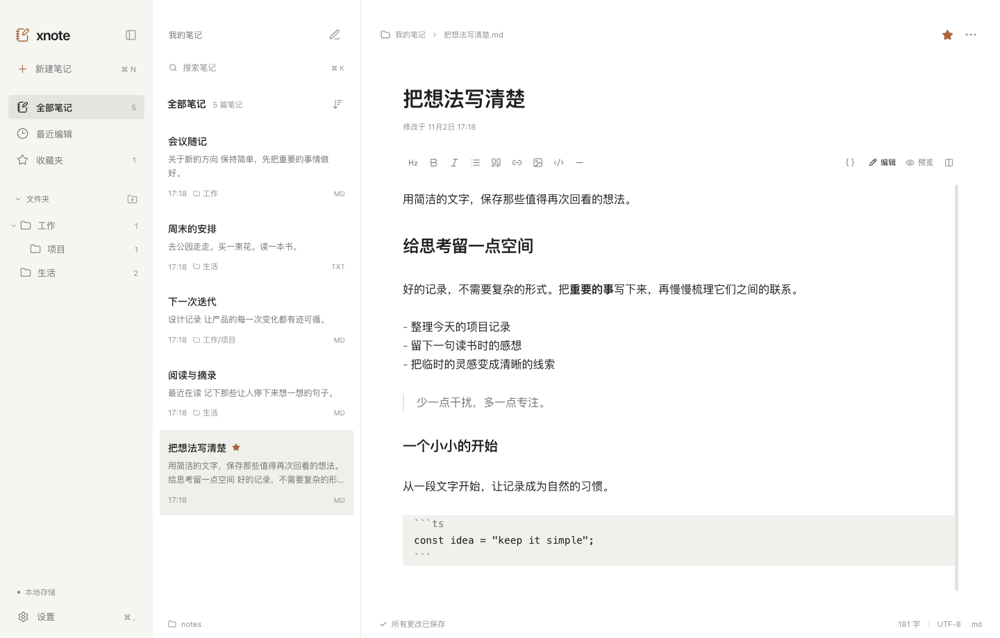

# xnote 第二轮 UI/UX 验证记录

日期：2026-11-02。目标：在现有三栏结构和真实文件功能上，形成更安静、以正文为中心的桌面 Markdown 笔记体验。

## 架构与调整范围

沿用 Electron、React、TypeScript、Vite、CodeMirror 6 和 Lucide，没有新增依赖，也没有迁移编辑器或文件服务。现有实现将三栏交互放在 `App.tsx`，编辑器、设置、弹窗已有独立组件；原全局 CSS 同时承载布局、主题、设置和响应式覆盖，局部样式容易相互影响。

本轮发现的主要问题是：笔记行和工具栏卡片感偏重，搜索框与导航装饰抢占注意力；辅助文字过小，元信息重复；设置背景有模糊效果；响应式固定宽度覆盖用户拖动结果；折叠导航后常用入口不足。

通过调整现有组件与样式完成优化：

- `src/theme.css` 统一颜色、字号、间距、圆角和交互变量。浅色以白色、`#F7F7F5` 和中性灰为主，深色使用对应中性灰，橙色只用于品牌、收藏等少量元素。
- `src/styles.css` 负责三栏、导航、平面列表和菜单；`src/components/settings.css` 单独承载设置及共享弹窗，编辑器视觉集中在 `editor.css`。
- 正文居中，最大内容宽度 800px；标题 30px、600 字重，默认正文 16px、1.7 行高。纯文本继续使用纯文本编辑体验。
- 列表通过留白、字体层级和轻微背景表达分组与选中。更多操作在悬停或键盘聚焦时显示；搜索与辅助信息融入列表。
- 导航支持文件夹分级展开和收起，底部存储状态与设置固定；折叠后保留 56px 导航轨道和常用入口。
- 工具栏透明且弱化，编辑、预览、分屏和原格式操作全部保留。设置、弹窗、右键菜单统一边框与阴影，不使用背景模糊。
- 两条分栏线保留拖动调整，增加方向键调整与焦点反馈；弹出菜单支持方向键、Home、End、Escape。修复菜单关闭后抢走重命名输入框焦点的问题，新建菜单跟随实际点击入口定位。

## Markdown 即时排版的边界

使用 CodeMirror 装饰呈现非当前行的标题、强调、行内代码和引用；光标或选区所在行显示原始标记。源码按钮可以随时显示全部标记。装饰不改写文档，保存的仍是原始 Markdown。

代码围栏、列表标记、链接和图片目标保留可编辑源码，完整渲染由原有预览提供。这是对现有源码编辑体验的渐进增强。超过 100,000 字符时自动使用源码编辑并禁用即时排版，避免移动光标时反复生成装饰影响长文档操作；预览和文件编辑继续可用。

## 功能保护与回归

本轮前后对以下文件执行摘要校验，内容一致：`server/store.ts`、`src/lib/useWorkspace.ts`、`src/lib/api.ts`、`src/types.ts`、`electron/main.ts`、`electron/preload.ts`。

文件命名、保存队列、外部同步、冲突处理、迁移、目录设置、IPC 和原生窗口逻辑没有修改。开发服务仅增加可选的 `XNOTE_WEB_PORT` / `XNOTE_API_PORT`，默认仍为 5173 / 4318，用于隔离现有开发实例。原生测试单独指定临时 user-data 目录，避免影响已运行的用户实例。

| 验证项             | 结果与覆盖                                                                                                                                   |
| ------------------ | -------------------------------------------------------------------------------------------------------------------------------------------- |
| 单元及真实文件测试 | 46/46 通过：27 项存储测试、12 项原编辑器测试、7 项即时排版测试。包括文档不变、选区显示源码、代码块和长文档回退。                             |
| 浏览器端到端测试   | 10/10 通过：原有真实文件流程及新增导航、文件夹、菜单、焦点、布局、设置、删除确认与内容保留测试。                                             |
| 生产构建           | `npm run build` 通过，包含 TypeScript 检查、Vite 和 Electron 主进程构建。                                                                    |
| 样式与代码格式     | Prettier 检查通过；受保护业务模块摘要校验通过。                                                                                              |
| 原生桌面功能       | 直接启动本轮打包的 Electron 应用，验证 IPC、真实文件新建/重命名/保存、浅深色切换和关闭窗口前保存。                                           |
| 原生多尺寸 UI      | 检查浅色、深色、预览、折叠导航、设置，及 860×600、1440×920、1920×1080 窗口；最大正文宽度 800px，未发现页面横向溢出或工具栏越界，无渲染异常。 |

测试数据来自独立临时目录中的实际 Markdown/TXT 文件。没有修改用户笔记目录或用静态列表替代文件读取。截图脚本写入的示例内容只用于隔离验收。

## 实际界面



其他检查截图：[深色](ui-round2-dark.png)、[Markdown 预览](ui-round2-preview.png)、[折叠导航](ui-round2-compact.png)、[设置](ui-round2-settings.png)、[860×600](ui-round2-narrow.png)、[1920×1080](ui-round2-wide.png)。截图来自真实 Electron 窗口，捕获时禁用动画以保证内容稳定。

## 启动、复验与安装包

完整启动及打包步骤见 [README](../README.md)。使用 Node.js 22.12+，本次验证使用 Node.js 24。

```bash
npm install
npm run dev:desktop
npm test
npm run build
npm run test:e2e
npm run test:desktop
npm run test:ui
```

如果已有开发服务占用默认端口，可独立运行：

```bash
XNOTE_WEB_PORT=5183 XNOTE_API_PORT=4328 XNOTE_HOME="$(mktemp -d /tmp/xnote-e2e-XXXXXX)" npm run test:e2e
```

本轮分发包独立放在 `release/ui-round2/`，保留先前输出：

- `release/ui-round2/mac-arm64/xnote.app`
- `release/ui-round2/xnote-1.0.0-arm64.dmg`
- `release/ui-round2/xnote-1.0.0-arm64-mac.zip`

已在 macOS ARM64 本机打包和运行。当前安装包未签名、未公证；Windows 和 Linux 未实机验证。
