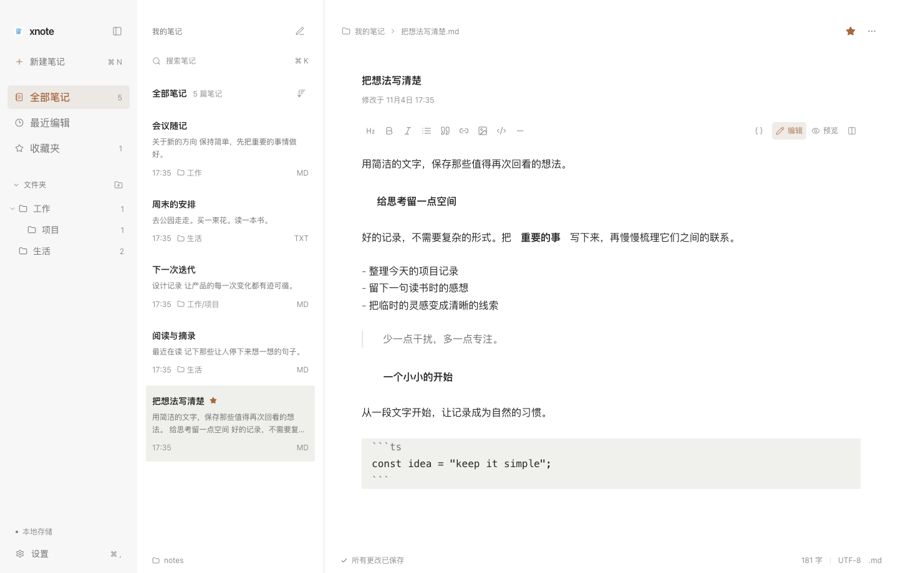

# xnote 第三轮 UI/UX 验证记录

日期：2026-11-04。范围：精修现有 Typora 式三栏界面，优先处理 Markdown 输入、格式、字体图标和响应式间距。保留 React、CodeMirror 6、react-markdown、Lucide 和既有本地文件架构，没有新增依赖。

## 代码排查与修复

编辑器不是富文本 contenteditable 自行拼装方案，而是 CodeMirror 6 源码编辑器；Markdown 语法树装饰控制非当前行标记的显示，react-markdown + remark-gfm 提供预览。样式由 theme.css 提供变量、styles.css 管理应用壳、editor.css 管理编辑与预览、settings.css 管理设置与弹窗。

- 原 `drawSelection()` 会用高优先级 CSS 隐藏原生 caret/selection，再以独立图层异步绘制。现在使用浏览器原生光标和选区，显式设置深灰/深色主题光标颜色，避免高优先级透明 caret 与额外测量图层的相互影响。选区使用浅橙色，失焦后使用浅灰色。
- 非当前行原来通过 `Decoration.replace` 删除 Markdown 标记的布局宽度，选区移入后又恢复宽度，可能重新折行。现在只隐藏标记的墨迹，保留源码几何宽度；源码开关继续可显示完整标记。此方式优先保证点击定位和中文输入稳定；它仍然是源码编辑器，不执行富文本到 Markdown 的保存转换。
- 斜体原本统一插入 `_`，英文单词内部不符合 CommonMark 规则；全局禁用字体合成也会让缺少原生斜体的中文系统字体看起来没有变化。现在常规斜体使用 `*`，只在编辑器和预览区域允许斜体合成。
- 格式操作按已解析的范围识别已有粗体/斜体，支持选区、光标位置、包含边缘空白的选区及部分取消。拆分嵌套强调时保留其他格式，并规避 CodeMirror 和预览解析器对连续星号的歧义；两个解析器均有回归断言。格式操作仍是单次可撤销事务。
- 工具栏显示当前格式状态，保留原生 Tooltip 和键盘快捷键。由预览直接执行格式操作时，先显示编辑器，再恢复焦点。
- Markdown 普通正文 Enter 插入段落分隔，Shift+Enter 插入两个尾随空格及换行；列表、引用、代码继续交由 CodeMirror Markdown 原生按键处理。TXT 使用普通换行，不注入 Markdown 空格或额外段落。
- 当前格式状态只沿选区语法节点祖先查找，避免每次键入或移动光标遍历整篇长文；原有超过 100,000 字符的即时排版回退保留。

## 视觉规范

- 字号统一为 12/14/16px；笔记页面标题与 Markdown 标题均不超过 16px，使用字重、颜色和间距区分。编辑器字号设置仅保留这三档，历史超范围值在显示层回退 16px，不修改配置或存储协议。
- Lucide 图标统一为 12/14/16px 和 1.6 描边，导航图标统一容器及对齐；新建菜单改用已有线性文件图标。品牌图片也收敛为 16px。
- 浅色导航背景为 #F9F9F9，选中项使用品牌橙色与浅暖灰底，悬停、按钮和文件夹箭头使用 140ms 过渡，保留减少动态效果偏好。
- 搜索、列表标题、笔记内容和底部目录信息共用列表留白变量；标题 14px，摘要、时间和类型 12px，摘要最多两行，选中行浅灰，无新增卡片边框或阴影。
- 正文采用 800px 最大内容宽度，以容器宽度和 clamp() 计算左右留白。标题、元信息、格式工具栏和正文共用对齐基准，宽屏居中，窄窗缩减边距；现有两侧分栏拖动和键盘调整继续保留。
- 编辑与预览沿用同一字体、颜色、16px 默认正文和 1.7 行高；引用细线、低对比度代码背景、克制橙色链接、图片最大宽度、表格细线、细滚动条保持统一。代码长行自动折行，表格在自身区域滚动。
- 保存中、失败、已保存保留不同文字和图标状态，成功使用柔和绿色；状态信息统一 12px，并为保存状态增加礼貌播报。

## 验证结果

| 验证               | 结果                                                                                                                      |
| ------------------ | ------------------------------------------------------------------------------------------------------------------------- |
| Vitest             | 53 项通过：27 项真实文件存储、19 项格式及 URL/图片、7 项即时排版                                                          |
| 完整浏览器 E2E     | 16 项通过，覆盖原有真实文件功能与新增编辑器交互                                                                           |
| 最终编辑器定向复验 | 6 项通过，包含从预览直接格式化后的焦点恢复                                                                                |
| 生产构建           | TypeScript、Vite、Electron 构建通过                                                                                       |
| 原生 Electron UI   | 浅色、深色、编辑、预览、折叠导航、设置、860×600 与 1920×1080 通过                                                         |
| 响应式及尺寸       | 640/860/1280/1920px 浏览器宽度无页面横向溢出；正文居中、最大 800px；可见字号和 Lucide 图标尺寸符合三档规范                |
| 输入专项           | 斜体选区/取消/后续输入、加粗、撤销、点击定位、选中文字、失焦恢复、中文合成输入、段落/软换行、列表/代码换行与 TXT 换行通过 |
| 业务模块保护       | server/store.ts、useWorkspace.ts、api.ts、types.ts、electron/main.ts、electron/preload.ts 修改前后 SHA-256 一致           |

测试使用隔离的临时目录和真实 Markdown/TXT 文件，没有使用用户笔记目录。中文合成输入通过 Chrome 原生 IME composition 协议测试；未逐一人工测试所有 macOS 第三方输入法的候选框。原生界面截图已实际查看。内置浏览器入口曾因自动审批超时无法打开，后续实测通过项目自己的 Chrome/Electron 测试流程完成。

## 本轮界面



其他截图：[深色](ui-round3-dark.png)、[Markdown 预览](ui-round3-preview.png)、[折叠导航](ui-round3-compact.png)、[设置](ui-round3-settings.png)、[860×600](ui-round3-narrow.png)、[1920×1080](ui-round3-wide.png)。

## 复验

使用 Node.js 22.12+；本轮使用 Node.js 24。默认 Playwright 浏览器未安装时，可选用本机 Chrome，选项不影响默认测试配置。

```bash
npm test
npm run build
XNOTE_BROWSER_CHANNEL=chrome XNOTE_WEB_PORT=5187 XNOTE_API_PORT=4337 XNOTE_HOME="$(mktemp -d /tmp/xnote-round3-XXXXXX)" npm run test:e2e
npm run test:ui:round3
```

源代码、生产构建及验收截图已更新；本轮未重新制作安装包。
