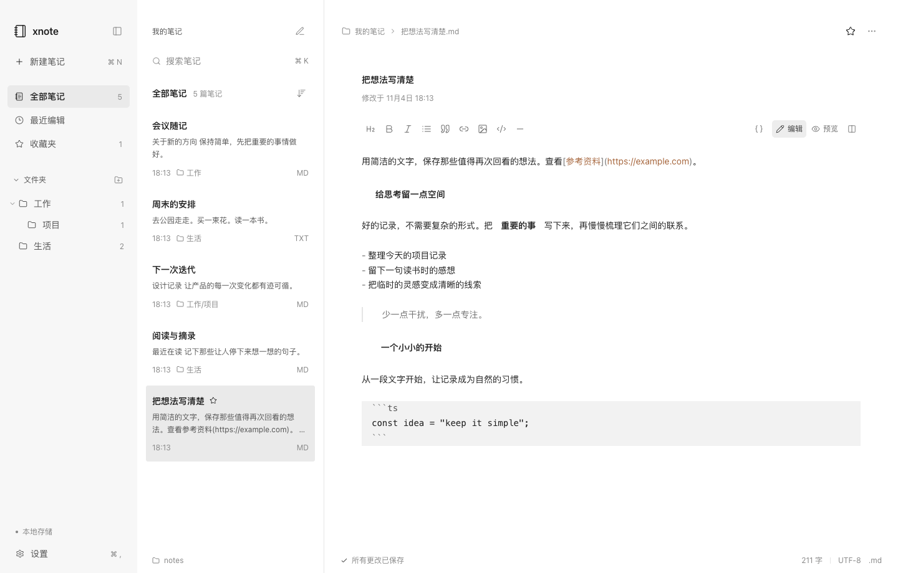

# xnote 灰度 UI 优化验收记录

日期：2026-11-04。本轮保留现有三栏、800px 正文最大宽度和 Typora 式编辑体验，集中调整品牌标识、字号和 UI 颜色。不增加依赖，不修改文件存储、保存队列或编辑事件。

## 实际改动

- 左上角原图标是带留白的彩色 favicon，缩小后显得过小。本轮改用项目现有 Lucide 的 Notebook Outline，图形实际占据 22px 品牌区域，配合 16px/600 的 xnote 文字与 8px 间距；图文垂直居中。功能图标仍限制为 12/14/16px，统一 1.6 描边。品牌 Logo 是按本轮要求保留的唯一 22px 例外。
- 一级导航、文件夹、笔记列表标题、正文顶部笔记标题、搜索和设置常规文字统一 14px；辅助信息与工具栏文字 12px；Logo 16px，默认正文 14px（后续字号调整）。导航正常字重 400，选中 500，笔记标题保持适当加粗。
- 主背景与列表/正文为 #FFFFFF，导航背景 #F9F9F9。主文字 #292929，次级文字 #666666，辅助 #999999，弱化 #B0B0B0，分割线 #EAEAEA。列表和导航 Hover #F5F5F5，按钮 Hover #F0F0F0，选中与按下背景 #EEEEEE。
- 导航、工具栏格式激活、编辑/预览切换、收藏、设置开关、菜单、弹窗、搜索高亮、焦点环、保存状态和滚动条均使用黑白灰 Token。收藏星标移除实心填充；保存失败和危险操作继续通过文案、图标及确认流程表达，交互没有删除。
- 颜色、字体、品牌尺寸、功能图标、描边、导航间距、禁用透明度和阴影集中在 theme.css。原有短变量保留为角色 Token 的别名，组件内不再写独立的颜色值；已有深色主题同步改为中性灰，未回退为浅色。
- Markdown 内容链接和语义灰色独立使用 --color-content-link / --color-content-muted，保留既有内容高亮。UI 激活色与正文语义色已解耦；正文中的链接仍可保留原有颜色。编辑器仅调整这两处颜色引用，不改输入、选区、格式或保存逻辑。
- 保留原生 title Tooltip，没有增加一套自定义悬浮提示组件。应用内空状态也改用同库单色 Outline 图标；系统安装图标与 Dock 资源未变更。

## 验证

| 项目               | 结果                                                                                                                                     |
| ------------------ | ---------------------------------------------------------------------------------------------------------------------------------------- |
| 单元与真实文件测试 | 53 项通过                                                                                                                                |
| 完整浏览器 E2E     | 16 项通过，含 Markdown/TXT、中文合成输入、光标、格式、保存竞争、收藏、搜索、文件夹与迁移                                                 |
| 生产构建           | TypeScript、Vite、Electron 构建通过                                                                                                      |
| 原生 Electron      | 浅色、深色、编辑、预览、折叠导航、空状态、三个设置页面、新建菜单、右键菜单和删除确认检查通过                                             |
| 品牌与字号         | Logo 22×22px，文字 16px，间距 8px，中心偏差小于 1px；导航、搜索、笔记标题与设置控件字号符合要求                                          |
| 灰度检查           | 对实际渲染 UI 的文字、背景、边框、焦点、图标填充和描边取色检查，未发现彩色 UI 元素；Markdown 内容区域按语义颜色例外处理                  |
| 图标检查           | 功能图标仅 12/14/16px，Outline，无实心填充，描边 1.6px                                                                                   |
| 交互状态           | 导航与工具栏选中、Hover、按下和键盘焦点使用同一灰度规范                                                                                  |
| 多尺寸             | 640～1920px 浏览器回归及 860×600/1440×920/1920×1080 原生窗口通过，正文最大 800px，无页面横向溢出                                         |
| 业务保护           | server/store.ts、useWorkspace.ts、api.ts、types.ts、electron/main.ts、electron/preload.ts、markdownPresentation.ts 修改前后 SHA-256 一致 |
| 独立审查           | 对照修改前快照复核三栏、字号、图标、语义颜色及覆盖关系，未发现需要修改的问题                                                             |

测试使用隔离的 /tmp 笔记目录和独立测试实例；没有修改用户笔记。截图已进行目视检查。源码与生产构建已更新，本轮没有重新制作安装包。

## 截图



[设置](ui-round4-settings.png)、[深色](ui-round4-dark.png)、[预览](ui-round4-preview.png)、[右键菜单](ui-round4-context.png)、[确认弹窗](ui-round4-dialog.png)、[空状态](ui-round4-empty.png)、[折叠导航](ui-round4-compact.png)、[窄窗口](ui-round4-narrow.png)、[宽屏](ui-round4-wide.png)。

## 打开最新版本

关闭之前运行的旧窗口，再在终端执行：

```bash
cd /Users/my_project/xnote
npm start
```

本轮修改已执行生产构建；release/ui-round2 仍是旧安装包。

## 复验命令

使用 Node.js 22.12+，本轮使用 Node.js 24。本机采用已安装的 Chrome，不增加浏览器依赖。

```bash
npm test
npm run build
XNOTE_BROWSER_CHANNEL=chrome XNOTE_WEB_PORT=5190 XNOTE_API_PORT=4340 XNOTE_HOME="$(mktemp -d /tmp/xnote-ui-gray-XXXXXX)" npm run test:e2e
npm run test:ui:round4
```
